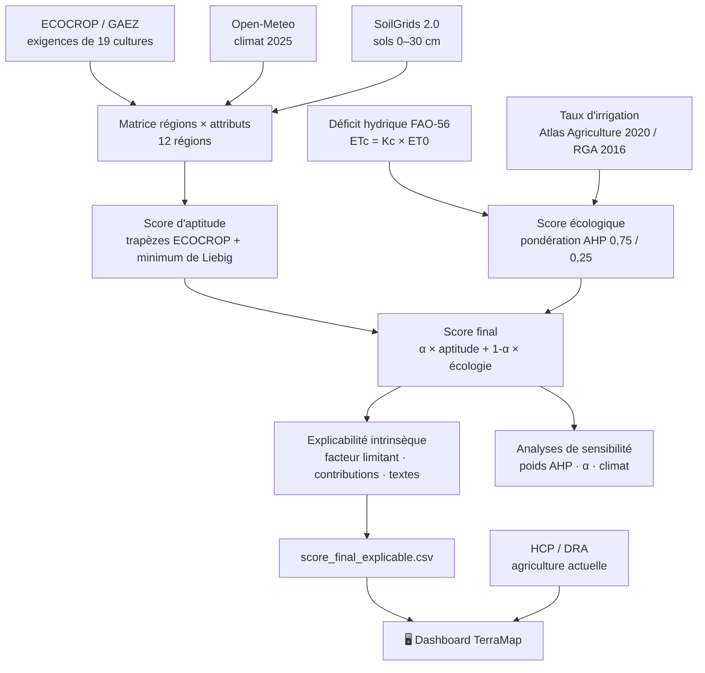
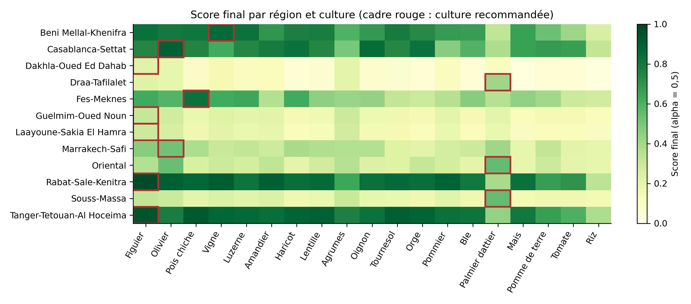
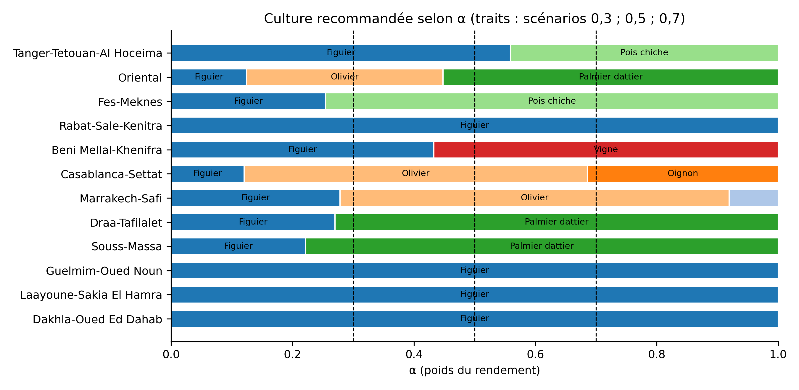
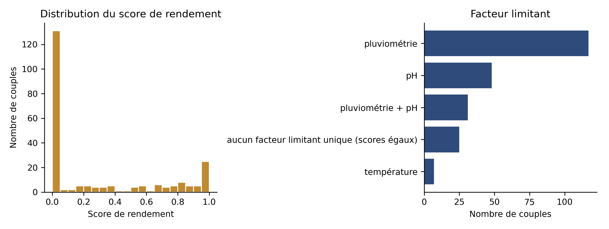
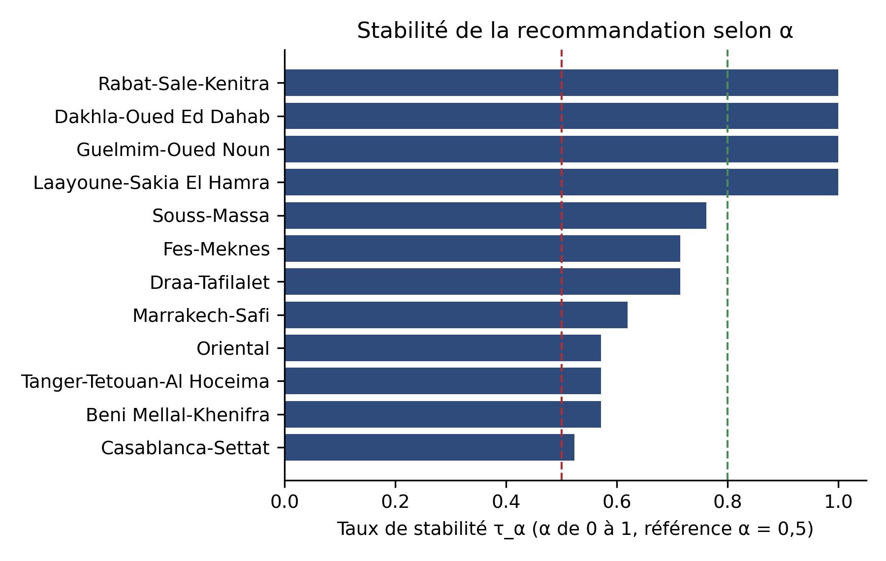

<div align="center">

# 🌍 TerraMap Maroc

**Cartographie des cultures les plus adaptées par région marocaine selon un compromis configurable entre aptitude agroécologique et contrainte hydrique**

[](https://terramap-maroc.vercel.app/)
[](#-installation)
[](#-installation)
[](#-dashboard-en-ligne)

Projet de fin d'études — Master Big Data · LaRIT, Université Ibn Tofail (Kénitra)

### 👉 [**Ouvrir le dashboard : terramap-maroc.vercel.app**](https://terramap-maroc.vercel.app/)

</div>

---

## 📑 Sommaire

1. [Présentation du projet](#-présentation-du-projet)
2. [Dashboard en ligne](#-dashboard-en-ligne)
3. [Pipeline global](#-pipeline-global)
4. [Sources de données](#-sources-de-données)
5. [Méthodologie : AHP + Weighted Scoring](#-méthodologie--ahp--weighted-scoring)
6. [Rôle du Machine Learning et explicabilité](#-rôle-du-machine-learning-et-explicabilité)
7. [Résultats principaux](#-résultats-principaux)
8. [Structure du dépôt](#-structure-du-dépôt)
9. [Installation](#-installation)
10. [Reproduire le pipeline](#-reproduire-le-pipeline)
11. [Limites](#-limites)
12. [Perspectives](#-perspectives)
13. [Auteur et encadrement](#-auteur-et-encadrement)

---

## 🎯 Présentation du projet

L'agriculture marocaine doit maintenir sa productivité tout en s'adaptant à une disponibilité de l'eau limitée et très hétérogène d'une région à l'autre. Recommander une culture sur un seul critère (le rendement potentiel, par exemple) peut conduire à négliger les contraintes hydriques et la durabilité.

**TerraMap Maroc** est un système d'aide à la décision **multicritère, transparent et explicable**. Il compare l'adéquation relative de **19 cultures** dans les **12 régions administratives** du Maroc (soit **228 couples région–culture**) selon deux dimensions :

| Dimension | Question posée | Méthode |
|---|---|---|
| **Aptitude agroécologique** (noté `score_rendement` dans le code) | Les conditions de la région (température, pluviométrie, pH) conviennent-elles à la culture ? | Fonctions d'appartenance trapézoïdales ECOCROP + loi du minimum de Liebig |
| **Score écologique** | La culture sollicite-t-elle fortement une ressource en eau déjà sous pression ? | Déficit hydrique climatique potentiel (FAO-56) + pression d'irrigation régionale, pondérés par AHP |

L'utilisateur règle lui-même le compromis grâce à un paramètre **α ∈ [0, 1]** : la culture recommandée dans une région est celle qui maximise le score final.

> ⚠️ **Lecture des scores.** Les scores sont des **indices relatifs d'aptitude et de contrainte hydrique**, pas des prévisions de rendement physique (q/ha). Les recommandations sont des **pistes de priorisation**, pas des prescriptions agronomiques.

### Questions de recherche abordées

- Comment construire, à partir de données ouvertes, un score d'aptitude culture–région reproductible ?
- Comment intégrer la contrainte hydrique et laisser l'utilisateur arbitrer entre aptitude et écologie ?
- Dans quelle mesure les recommandations dépendent-elles du paramètre α, du jugement AHP et du climat de référence ?
- Comment expliquer chaque recommandation (facteur limitant, composante dominante) sans modèle boîte noire ?

---

## 🖥️ Dashboard en ligne

**🔗 https://terramap-maroc.vercel.app/**

Le dashboard est une application frontend (HTML, CSS, JavaScript, **Vite**, **Leaflet.js**) qui lit directement les CSV produits par le pipeline Python. Il n'altère jamais les scores calculés.

**Fonctionnalités**

- 🗺️ Carte interactive des **12 régions** (limites GeoJSON locales), avec un repère de score par région
- 🎚️ Curseur **α** pour les trois scénarios : `0,3` écologie prioritaire · `0,5` équilibré · `0,7` rendement prioritaire
- 🔍 Filtres par culture et par région, indicateurs de synthèse (score moyen, meilleure adéquation, dominante)
- 🧾 **Panneau d'explicabilité** : score rendement, score écologique, composante dominante, facteur limitant, explication textuelle
- 📊 Classement des couples région–culture selon le scénario actif
- 🌾 **Confrontation avec la réalité agricole** (HCP/DRA) : cultures observées, superficies, rendements, écart de score
- 📥 Import manuel d'un CSV de scores

Les valeurs manquantes des données agricoles ne sont **jamais converties en zéro** : une culture peut être documentée sans superficie ni rendement.

---

## 🔄 Pipeline global



---

## 🗃️ Sources de données

Toutes les sources sont ouvertes ou officielles. Chaque fichier a été audité avant utilisation (voir [Audit des données](#audit-des-données)).

| Domaine | Source | Variables utilisées | Fichier produit |
|---|---|---|---|
| Exigences des cultures | **FAO ECOCROP / GAEZ v4** | Bornes de température, pluviométrie et pH (min, optimum min/max, max) pour 19 cultures | `data_processed/exigences_cultures.csv` |
| Climat | **Open-Meteo** (API) | Température, précipitations, ET₀ FAO Penman–Monteith — année civile 2025 | `data_processed/donnees_climatiques.csv` |
| Sols | **SoilGrids 2.0** (ISRIC) | pH, argile, sable, limon, carbone organique (0–30 cm, moyenne 3 × 3 pixels) | `data_processed/donnees_sols.csv` |
| Coefficients culturaux | **FAO-56** (Allen et al., 1998) et Paredes et al. (2024) pour le figuier | `Kc_mid` par culture | `data_processed/kc_values.csv` |
| Irrigation | **Atlas de l'Agriculture Marocaine**, 3ᵉ éd. (2020), fondé sur le RGA 2016 | SAU irriguée / SAU, pour les 12 régions | `data_processed/donnees_ecologie.csv` |
| Agriculture actuelle | **Monographies régionales HCP et DRA** | Superficie, rendement, source, année, note | `data_processed/agriculture_actuelle.csv` |

**Périmètre** : 12 régions administratives (chacune représentée par un point, sa capitale) · 19 cultures : blé, orge, maïs, riz, pois chiche, lentille, haricot, tournesol, olivier, agrumes, amandier, figuier, pommier, vigne, tomate, pomme de terre, oignon, luzerne, palmier dattier.

### Audit des données

Une partie des données initialement collectées s'est révélée **modélisée ou non vérifiable** (valeurs fournies par un assistant IA lors de blocages d'accès aux sources officielles). Un audit rétroactif a été mené sur les cinq fichiers du data lake :

- 🔧 **Sols** : corrections d'unité (`organic_carbon`), changement de méthode de lecture SoilGrids (mosaïques VRT) et projection Homolosine corrigée ; méthodologie unifiée pour les 12 régions.
- 🔧 **Écologie** : indicateurs AQUASTAT écartés (échelle géographique incompatible) puis remplacés par une source unique et homogène (Atlas, RGA 2016).
- 🔧 **Agriculture actuelle** : reconstruction intégrale depuis les monographies HCP/DRA avec traçabilité complète (`source_doc`, `annee`, `note`).
- ✅ **Climat** et **exigences ECOCROP** : vérifiés comme fiables.

Principes retenus : aucune valeur inventée, une cellule vide signifie « non disponible dans la source » (jamais « culture absente »), et chaque ligne agricole garde sa référence.

---

## 🧮 Méthodologie : AHP + Weighted Scoring

Le score final est un **Weighted Scoring** à deux niveaux : une agrégation non compensatoire pour l'aptitude, une pondération **AHP** pour la dimension écologique, puis une somme pondérée réglable par α.

### 1. Score d'aptitude : fonctions trapézoïdales + loi du minimum de Liebig

Pour chaque critère *x* (température moyenne, pluviométrie annuelle, pH), un score d'appartenance dans [0, 1] est calculé à partir des quatre bornes ECOCROP *(Vmin, Vopmin, Vopmax, Vmax)* :

```text
S(x) = 0                              si x < Vmin ou x > Vmax
     = (x − Vmin)/(Vopmin − Vmin)      sur la phase ascendante
     = 1                               dans l'intervalle optimal [Vopmin, Vopmax]
     = (Vmax − x)/(Vmax − Vopmax)      sur la phase descendante

Score_rendement(r, c) = min( S_temp(r,c), S_pluie(r,c), S_pH(r,c) )
```

Le minimum signifie qu'**une condition très favorable ne compense pas une condition fortement défavorable**. Il permet aussi d'identifier le **facteur limitant** (température, pluviométrie, pH, ou plusieurs en cas d'égalité). La texture du sol n'est pas intégrée au score quantitatif (champ `TEXT` d'ECOCROP catégoriel ; argile, sable et limon sont des données compositionnelles dont la somme vaut 100 %).

### 2. Score écologique : déficit hydrique + pression d'irrigation

```text
ETc(r,c)       = Kc_mid(c) × ET0(r)                       (FAO-56)
Déficit(r,c)   = max(0, ETc(r,c) − Pluie(r))
S_déficit(r,c) = 1 − MinMax(Déficit)                      sur les 228 couples

TI(r)          = 100 × SAU_irriguée(r) / SAU(r)
S_irrig(r)     = 1 − MinMax(TI)                           sur les 12 régions
```

> Le déficit calculé est un **indicateur climatique comparatif annuel** (pas de courbe `Kc_ini → Kc_mid → Kc_end`, pas de bilan hydrique saisonnier). Il ne s'agit pas d'un besoin d'irrigation exact.

### 3. Pondération AHP

Les deux composantes sont agrégées par une matrice de comparaison par paires 2 × 2 (échelle de Saaty). Le déficit hydrique, propre à chaque couple région–culture, est jugé **modérément plus important** (a = 3) que la pression d'irrigation, facteur régional de contexte :

```text
w_d = a/(a+1) = 0,75        w_i = 1/(a+1) = 0,25

Score_éco(r,c) = 0,75 × S_déficit(r,c) + 0,25 × S_irrig(r)
```

> **Précision méthodologique.** Pour une matrice 2 × 2, le ratio de cohérence vaut toujours 0 : ce n'est pas une preuve de qualité du jugement. C'est un jugement unique de l'auteur, sans panel d'experts, d'où l'analyse de sensibilité sur `w_d` (0,50 → 0,90).

### 4. Score final configurable

```text
Score_final(r, c ; α) = α × Score_rendement(r, c) + (1 − α) × Score_éco(r, c)

Culture recommandée(r) = argmax_c Score_final(r, c ; α)
```

| α | Interprétation |
|---:|---|
| **0,3** | 🌱 Écologie prioritaire |
| **0,5** | ⚖️ Compromis équilibré |
| **0,7** | 🌾 Rendement prioritaire |

### 5. Analyses de sensibilité

| Analyse | Protocole | Résultat |
|---|---|---|
| **Poids AHP** | `w_d` de 0,50 à 0,90 (pas de 0,05, 9 configurations) × 3 valeurs de α = 36 cas | 33 cas sur 36 robustes (τ_w ≥ 0,80), 3 intermédiaires à 0,78, aucun sensible |
| **Paramètre α** | α de 0 à 1 (pas de 0,05), référence α = 0,5 | 4 régions robustes, 8 intermédiaires, aucune sensible ; seuils de bascule calculés exactement |
| **Climat de référence** | Moyenne 2015–2024 à la place de l'année 2025 | 8, 5 et 6 régions sur 12 conservent leur recommandation (α = 0,3 / 0,5 / 0,7) ; couples à score nul : 131 → 144 ; corrélation de rang moyenne de 0,80 à 0,87 |

Le jugement AHP est donc **peu déterminant**, alors que le choix de α et le climat de référence le sont beaucoup plus.

---

## 🤖 Rôle du Machine Learning et explicabilité

**Aucun modèle de Machine Learning n'est entraîné dans la version actuelle.** TerraMap est volontairement un système MCDA (aide à la décision multicritère), pas un modèle prédictif de rendement. Ce choix est assumé :

- avec 12 régions et 228 couples dont les scores sont eux-mêmes calculés par règles, un modèle ML ne ferait que **réapprendre une décision déjà explicite** ;
- les règles agronomiques (bornes ECOCROP, minimum de Liebig, poids AHP) sont lisibles, reproductibles et contrôlables par un expert ;
- la transparence est plus défendable scientifiquement qu'un modèle ajouté artificiellement.

### Explicabilité intrinsèque (`scripts/scripts_explicabilite_intrinseque.py`)

L'explicabilité est intégrée aux règles de calcul, sans modèle auxiliaire. Pour chaque couple et chaque α, le script produit :

- les **contributions** `α × Score_rendement` et `(1 − α) × Score_éco` et la **composante dominante** ;
- le **facteur limitant** selon Liebig (égalités traitées explicitement) ;
- le **rang**, l'écart avec la culture suivante et la stabilité sur les trois scénarios ;
- une **explication textuelle** lisible, affichée dans le dashboard.

> *Exemple :* « Figuier obtient un score final de 0,938 pour alpha = 0,5. Le score de rendement est 0,875 et le score écologique est 1,000. La composante dominante est écologie. Le facteur limitant selon Liebig est pH. »

### Machine Learning : perspectives

Le ML est conservé comme **extension future** : validation des scores MCDA (Random Forest / XGBoost), explicabilité par SHAP ou LIME, prédiction de rendement sur un corpus plus large, apprentissage de pondérations à partir de données historiques, comparaison avec des modèles supervisés.

---

## 📈 Résultats principaux

| Indicateur | Valeur |
|---|---|
| Couples région–culture évalués | **228** (12 régions × 19 cultures) |
| Couples à score d'aptitude nul (climat 2025) | **131** (57,5 %), dominés par la pluviométrie |
| Cultures recommandées (36 recommandations, 3 scénarios) | figuier 15 · palmier dattier 8 · olivier 6 · pois chiche 4 · vigne 2 · oignon 1 |
| Régions à recommandation stable sur les 3 scénarios | **8 sur 12** |
| Régions qui changent de culture selon α | Tanger-Tétouan-Al Hoceïma, Oriental, Béni Mellal-Khénifra, Casablanca-Settat |
| Couples avec superficie et rendement observés | **57 sur 228** (25 %) |
| Recommandation alignée avec la culture observée | 3 régions documentées sur 10 |

### Recommandations par région

| Région | α = 0,3 | α = 0,5 | α = 0,7 |
|---|---|---|---|
| Tanger-Tétouan-Al Hoceïma | Figuier | Figuier | Pois chiche |
| Oriental | Olivier | Palmier dattier | Palmier dattier |
| Fès-Meknès | Pois chiche | Pois chiche | Pois chiche |
| Rabat-Salé-Kénitra | Figuier | Figuier | Figuier |
| Béni Mellal-Khénifra | Figuier | Vigne | Vigne |
| Casablanca-Settat | Olivier | Olivier | Oignon |
| Marrakech-Safi | Olivier | Olivier | Olivier |
| Drâa-Tafilalet | Palmier dattier | Palmier dattier | Palmier dattier |
| Souss-Massa | Palmier dattier | Palmier dattier | Palmier dattier |
| Guelmim-Oued Noun | Figuier | Figuier | Figuier |
| Laâyoune-Sakia El Hamra | Figuier | Figuier | Figuier |
| Dakhla-Oued Ed Dahab | Figuier | Figuier | Figuier |

> Dans les trois régions du Sud, le figuier reste premier parce que le score d'aptitude y est nul pour toutes les cultures : le classement y est purement écologique. Treize recommandations sur 36 sont séparées de la deuxième culture par moins de 0,02, ce qui invite à lire le classement comme une hiérarchie d'options proches.

### Figures

<table>
<tr>
<td align="center"><br><sub>Score final par région et culture (α = 0,5)</sub></td>
<td align="center"><br><sub>Culture recommandée selon α</sub></td>
</tr>
<tr>
<td align="center"><br><sub>Distribution du score d'aptitude et facteurs limitants</sub></td>
<td align="center"><br><sub>Stabilité de la recommandation selon α</sub></td>
</tr>
</table>

---

## 📁 Structure du dépôt

```text
TerraMap-Maroc/
├── data_raw/                         # Données brutes (régions, ECOCROP, Kc, tuiles SoilGrids)
├── data_processed/                   # Données nettoyées et scores intermédiaires/finaux
│   ├── donnees_climatiques.csv
│   ├── donnees_sols.csv
│   ├── donnees_ecologie.csv
│   ├── exigences_cultures.csv
│   ├── agriculture_actuelle.csv
│   ├── score_rendement_r_c.csv
│   ├── deficit_hydrique_r_c.csv
│   ├── score_ecologique_final.csv
│   ├── score_final_r_c.csv
│   └── score_final_explicable.csv    # ← table centrale lue par le dashboard
├── scripts/                          # Pipeline Python (collecte → scores → explicabilité → résultats)
├── sorties_sensibilite/              # Sensibilité aux poids AHP et à α
├── robustesse_climat_2015_2024/      # Test de robustesse au climat de référence
├── sorties_resultats_ch4/            # Tableaux et figures de résultats
├── sorties_complements_ch4/          # Compléments (contributions, intervalles, bascules de α)
└── terramap-dashboard/               # Application web (Vite + Leaflet), déployée sur Vercel
    ├── index.html
    ├── src/ (main.js, styles.css)
    └── public/data/                  # score_final_explicable.csv · agriculture_actuelle.csv · morocco-regions.geojson
```

---

## ⚙️ Installation

### Prérequis

- **Python 3.9+** (pipeline de calcul)
- **Node.js 18+** et **npm** (dashboard)
- **Git**

### 1. Cloner le dépôt

```bash
git clone https://github.com/ouumii/TerraMap-Maroc.git
cd TerraMap-Maroc
```

### 2. Lancer le dashboard en local

```bash
cd terramap-dashboard
npm install
npm run dev
```

Le dashboard est alors disponible sur **http://localhost:3000**. Les données lues se trouvent dans `terramap-dashboard/public/data/`.

Pour générer la version de production (dossier `dist/`) :

```bash
npm run build
```

> **Déploiement.** Le dashboard en ligne est hébergé sur [Vercel](https://vercel.com). Pour déployer une copie : importer le dépôt, choisir `terramap-dashboard` comme dossier racine, preset **Vite**, commande de build `npm run build`, dossier de sortie `dist`.

### 3. Environnement Python (pour rejouer le pipeline)

```bash
python -m venv .venv
source .venv/bin/activate          # Windows : .venv\Scripts\activate
pip install pandas numpy matplotlib
pip install requests rasterio pyproj   # uniquement pour la collecte (Open-Meteo, SoilGrids)
```

---

## 🔁 Reproduire le pipeline

> ⚠️ **Chemins.** Plusieurs scripts contiennent des chemins absolus Windows (par ex. `D:\terramap_maroc\data_processed\...`) dans leur section `CONFIG` ou en constantes en tête de fichier. **Adaptez-les à votre arborescence** avant exécution.

Ordre d'exécution des scripts de `scripts/` :

| Étape | Script | Rôle |
|---|---|---|
| 1 | `collect_open_meteo.py` | Collecte du climat (Open-Meteo) |
| 2 | `collecte_soilgrids_final.py` | Collecte des sols (SoilGrids, mosaïques VRT) |
| 3 | `extract_ecocrop.py` · `filtrage_ecocrop.py` | Extraction et filtrage des exigences des 19 cultures |
| 4 | `construire_matrice_region_attributs.py` · `normaliser_matrice_region_attributs.py` · `analyser_correlations_attributs.py` | Matrice régions × attributs, normalisation, corrélations |
| 5 | `calcul_score_rendement.py` | Score d'aptitude (trapèzes + minimum de Liebig) |
| 6 | `calcul_deficit_hydrique.py` · `calcul_score_irrigation.py` · `calcul_score_ecologique_final.py` | Score écologique (FAO-56 + irrigation + AHP) |
| 7 | `calcul_score_final.py` | Score final pour α = 0,3 / 0,5 / 0,7 |
| 8 | `scripts_explicabilite_intrinseque.py` | Produit `score_final_explicable.csv` |
| 9 | `sensibilite_poids_ahp.py` · `robustesse_climat_2015_2024/script.py` | Analyses de sensibilité |
| 10 | `resultats_chapitre4.py` · `complements_chapitre4.py` | Tableaux et figures de résultats |

Les fichiers intermédiaires étant versionnés dans `data_processed/`, il est possible de **partir de n'importe quelle étape** sans refaire la collecte. Pour mettre à jour le dashboard, copier le nouveau `score_final_explicable.csv` dans `terramap-dashboard/public/data/`.

---

## ⚠️ Limites

- **Scores relatifs.** Le score d'aptitude n'est pas une prédiction de rendement ; il est évalué principalement en conditions pluviales et ne représente pas l'effet de l'irrigation.
- **Climat 2025.** Les variables climatiques correspondent à l'année 2025 (plus humide que la moyenne 2015–2024 dans sept régions) et non à une normale de 30 ans. Le test de robustesse en mesure l'effet : les recommandations y sont sensibles.
- **Représentation ponctuelle.** Chaque région est caractérisée par un point (sa capitale), alors que les régions sont hétérogènes.
- **Déficit hydrique approché.** Formulation annuelle avec `Kc_mid` seul, sans bilan hydrique saisonnier.
- **Normalisation relative.** Les scores 0 et 1 sont relatifs à l'échantillon étudié, pas des seuils agronomiques absolus.
- **AHP à jugement unique.** Pas de panel d'experts ; le ratio de cohérence d'une matrice 2 × 2 est trivial.
- **Texture et nappes non intégrées.** La texture du sol est exclue du score quantitatif ; l'état des nappes (ABH) n'a pas de source officielle vérifiable pour les 12 régions.
- **Couverture agricole partielle.** 57 couples sur 228 (25 %), dominés par les céréales (années et granularités hétérogènes). Un écart entre recommandation et situation observée n'est pas une preuve de sous-optimisation : prix, marchés, infrastructures et savoir-faire ne sont pas modélisés.

---

## 🔭 Perspectives

- Normale climatique pluriannuelle et scénarios de changement climatique
- Statistiques zonales sur les polygones régionaux au lieu d'un point par région
- Modèle FAO-56 complet avec calendriers culturaux, et représentation explicite des conditions irriguées
- Réintroduction de la texture du sol avec une règle agronomiquement validée
- Indicateurs vérifiés sur les ressources souterraines
- Validation par un **panel d'agronomes** et évaluation de l'interface auprès d'utilisateurs
- Extensions ML : validation des scores, SHAP/LIME, prédiction de rendement sur corpus élargi

---

## 👩‍💻 Auteur et encadrement

**Oumaima ELBOUZAIDI** — Master Big Data, Intelligence Artificielle et Applications Avancées
Laboratoire **LaRIT**, Université **Ibn Tofail**, Kénitra, Maroc
GitHub : [@ouumii](https://github.com/ouumii)

**Dashboard :** https://terramap-maroc.vercel.app/ · **Dépôt :** https://github.com/ouumii/TerraMap-Maroc

### Référence principale

> TerraMap Maroc : une approche multicritère explicable pour cartographier l'adéquation des cultures aux régions marocaines selon un compromis entre aptitude et contrainte hydrique. Projet de fin d'études, Master Big Data, LaRIT, Université Ibn Tofail, 2026.

### Licence

Projet académique. La licence de réutilisation du code et des données reste à préciser. Les données sources (ECOCROP/GAEZ, Open-Meteo, SoilGrids, Atlas de l'Agriculture Marocaine, HCP/DRA) restent soumises à leurs conditions d'utilisation respectives.
